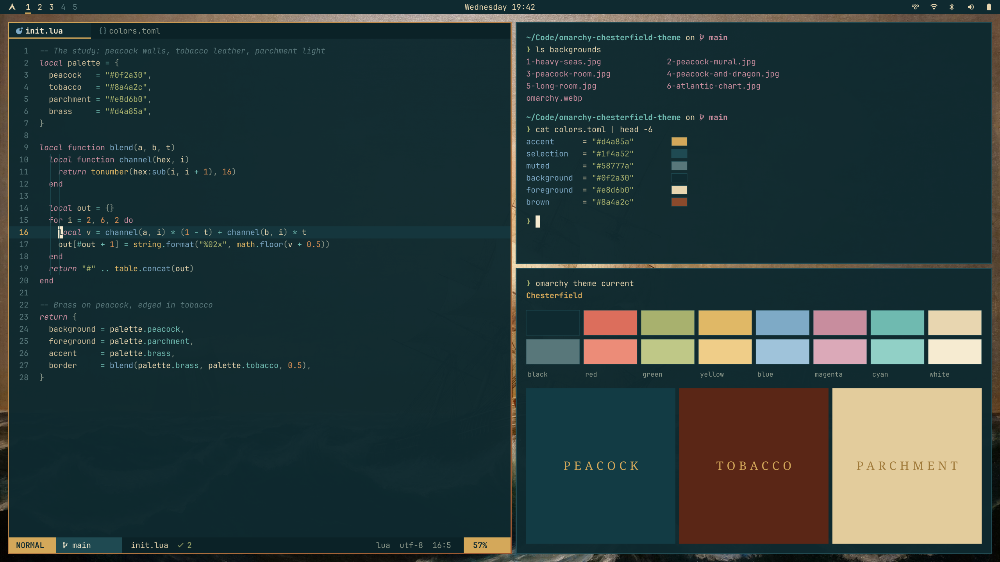

# Chesterfield

A dark theme for [Omarchy Quattro](https://github.com/omacom/omarchy), from the materials of an old study: peacock plaster, tobacco leather, and parchment. Brass is the accent color.



## Install

```bash
omarchy theme install https://github.com/bjarneo/omarchy-chesterfield-theme
```

## Palette

| Role | Color | Source |
|------|-------|--------|
| `background` | `#0f2a30` | Peacock plaster |
| `foreground` | `#e8d6b0` | Parchment |
| `accent` | `#d4a85a` | Brass lettering |
| `brown` | `#8a4a2c` | Tobacco leather |
| `selection` | `#1f4a52` | Lighter peacock |

The active window border is a gradient from brass to tobacco. All text colors have a contrast ratio of 4.5:1 or more on the background. The `muted` color is 3.1:1, for comments and inactive text.

The theme ships only `colors.toml`. Omarchy generates the terminal, Neovim, btop, Hyprland, and shell files from it.

## Wallpapers

| File | Work | License |
|------|------|---------|
| `1-heavy-seas.jpg` | Fitz Henry Lane, [*Three Master and Lumber Schooners in Heavy Seas*](https://commons.wikimedia.org/wiki/File:Three_Master_and_Lumber_Schooners_in_Heavy_Seas,_by_Fitz_Henry_Lane,_early_1850s,_oil_on_canvas_-_Cape_Ann_Museum_-_Gloucester,_MA_-_DSC01172.jpg), early 1850s. Cape Ann Museum | Public domain |
| `2-peacock-mural.jpg` | James McNeill Whistler, *Harmony in Blue and Gold: The Peacock Room*, 1876–77. Photo: [Freer Gallery of Art](https://commons.wikimedia.org/wiki/File:Whistler_-_Harmony_in_Blue_and_Gold_The_Peacock_Room,_FS-F1904.61_028.jpg) | Public domain |
| `3-peacock-room.jpg` | James McNeill Whistler, *Harmony in Blue and Gold: The Peacock Room*. Photo: [Freer Gallery of Art](https://commons.wikimedia.org/wiki/File:Whistler_-_Harmony_in_Blue_and_Gold_The_Peacock_Room,_FS-F1904.61_006.jpg) | Public domain |
| `4-peacock-and-dragon.jpg` | William Morris, [*Peacock and Dragon*](https://commons.wikimedia.org/wiki/File:Designed_by_William_Morris_-_Panel_Entitled_%22Peacock_and_Dragon%22_-_Google_Art_Project.jpg), woven textile, 1878 | Public domain |
| `5-long-room.jpg` | [Long Room, Trinity College Dublin](https://commons.wikimedia.org/wiki/File:Long_Room_Interior,_Trinity_College_Dublin,_Ireland_-_Diliff.jpg). Photo: Diliff | [CC BY-SA 4.0](https://creativecommons.org/licenses/by-sa/4.0/) |
| `6-atlantic-chart.jpg` | Pascoal Roiz, [*Portolan chart of the Atlantic Ocean*](https://www.loc.gov/item/2008621738/), 1633. Library of Congress | Public domain |
| `omarchy.webp` | Omarchy logo in brass on peacock | Omarchy |

All wallpapers are cropped to 3840×2160. They have a light vignette and a small color adjustment. `5-long-room.jpg` is an adaptation of the original photo and is shared under the same CC BY-SA 4.0 license.
